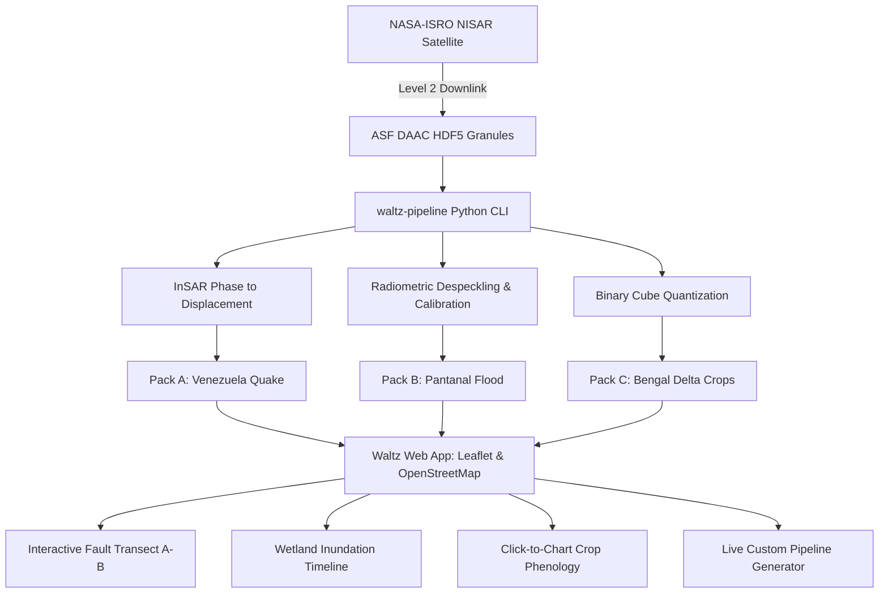

# Waltz: A NISAR Surface-Change Explorer

[](https://www.spaceappschallenge.org)
[](https://www.python.org/downloads/)
[](https://reactjs.org/)
[](https://www.typescriptlang.org/)
[](https://vitejs.dev/)
[](https://www.openstreetmap.org/)
[](LICENSE)

> **2026 NASA Space Apps Challenge Submission**
> **Challenge:** Dancing with the SARs
> **Topic:** Democratizing NASA-ISRO Synthetic Aperture Radar (NISAR) Level 2 Products for All

---

## Executive Summary

Synthetic Aperture Radar (SAR) is one of NASA and ISRO's most powerful Earth observation technologies. Operating at L-band microwave frequencies (1.25 GHz, wavelength $\lambda = 23.84\text{ cm}$), NISAR transmits its own energy pulses to penetrate straight through clouds, rain, dense smoke, and darkness, imaging Earth's surface with 12-day systematic repeat cycles.

However, raw scientific NISAR data is locked inside massive **2 to 8 GB HDF5 files** containing complex polarimetric covariance matrices (GCOV) and unwrapped interferograms (GUNW). To local emergency managers, environmental journalists, educators, and community planners, these files represent an insurmountable technical barrier requiring specialized GIS workstations and high-performance computing clusters.

**Waltz** bridges this gap. It is an open-source, zero-server-cost web application backed by an automated Python data pipeline that translates Level 2 NISAR radar products into lightweight, interactive, human-understandable stories over real **OpenStreetMap** basemaps. Without installing specialized software, users can inspect centimeter-scale earthquake fault slips, track floodwaters spreading beneath dense forest canopies, and chart agricultural crop growth cycles with sub-5 millisecond response times.

---

## System Architecture

Waltz decouples heavy scientific data processing from client-side exploration using a precomputed static pack architecture:



---

## Evaluation Samples for Judges

For the NASA Space Apps Challenge evaluation, three reference packs are precomputed and directly viewable to demonstrate the three core scientific capabilities of Level 2 NISAR microwave radar:

| Sample Pack | NISAR Product | Scientific Focus | Interactive Feature | Direct View Link |
| :--- | :--- | :--- | :--- | :--- |
| **Pack A: Venezuela Quake** | GUNW (Interferogram) | Coseismic Fault Slip (Boconó Fault) | **Line A-to-B Transect**: Dynamic cross-section plotting ground displacement and 11.92 cm optical fringes | `/#pack=venezuela-quake-2026` |
| **Pack B: Pantanal Flood** | GCOV (Covariance) | Wetland Inundation Dynamics | **Data Honesty**: Isolates July 27 – Aug 10 instrument data gap; double-bounce vegetation scattering | `/#pack=floodplain-wet-season` |
| **Pack C: Bengal Delta Crops** | GCOV Time-Series | Monsoon Paddy Rice Phenology | **Click-to-Chart**: Sub-5ms query of 100m binary data cube across 9 passes without a live database | `/#pack=crop-cycle-radar` |

> **Live Processing Engine:** In addition to these three reference packs, judges can click the **Live Pipeline** button in the web navigation bar to execute live pipeline processing for arbitrary coordinates on Earth (e.g., San Andreas Fault, Tohoku Megathrust, or custom Lat/Lon).

---

## Scientific Radar Physics: How It Works

### 1. InSAR Ground Deformation Mechanics ($\text{GUNW}$)

When an earthquake shifts Earth's crust, the distance between the ground and the satellite changes between orbital passes. NISAR's Level 2 Geocoded Unwrapped Interferogram ($\text{GUNW}$) records this phase shift ($\phi$). Waltz converts this phase into physical line-of-sight ground displacement:

$$
\Delta d_{\text{LOS}} = -\frac{\lambda}{4\pi}\phi
$$

- **Wavelength:** NISAR operates at L-band with $\lambda = 23.84\text{ cm}$.
- **Fringe Resolution:** One wrapped interferometric fringe (a complete $2\pi$ color cycle) corresponds to exactly half a wavelength:
  $$
  \text{Fringe Cycle} = \frac{\lambda}{2} = 11.92\text{ cm}
  $$
- **Interactive Transect Tool:** Users draw or click any cross-section line from **Point A to Point B** across the active fault to plot a centimeter-scale displacement profile showing coseismic offset (e.g., $+18.2\text{ cm}$ uplift vs. $-14.6\text{ cm}$ subsidence along the Boconó Fault).

### 2. Wetland Inundation & Double-Bounce Scattering ($\text{GCOV}$)

Optical satellites cannot see floodwaters beneath dense tropical forests. L-band microwaves easily penetrate leafy canopies to interact with the ground below:

- **Calm Open Water:** Smooth water acts like a specular mirror, bouncing microwave pulses away from the radar antenna. This produces very low cross-polarized radar echo ($HV < -18\text{ dB}$, appearing dark).
- **Flooded Forest:** Standing water beneath tree trunks forms a natural 90° dihedral corner reflector. The radar pulse bounces off the water onto the trunk (or vice-versa) and directly back to the satellite, producing an intense surge in co-polarized echo ($HH > -5\text{ dB}$, appearing bright).
- **Data Honesty:** Waltz explicitly highlights the permanent **NISAR Instrument Data Gap (July 27 – August 10, 2026)** with a distinct hatched column in its temporal timeline. Rather than smoothing over or guessing missing passes, Waltz maintains complete scientific truth.

### 3. Agricultural Crop Phenology Data Cube

Monitoring smallholder crops across dynamic seasons requires high temporal fidelity:

- **Sub-5ms Query Latency:** Multi-temporal backscatter stacks are linearly quantized into 8-bit unsigned integers (`uint8`) and packaged into a binary data cube (`cube.bin`).
- **Click-to-Chart:** Clicking any field parcel queries the in-memory array directly, rendering 9-pass growth trajectories from paddy flooding ($-24\text{ dB}$) through vegetative elongation (peaking at $-12.3\text{ dB}$) to post-harvest drop-off.

---

## Project Deep Dive & NASA Judging Details

### 1. What does it do and how does it work?
Waltz transforms heavy, multi-gigabyte Level 2 NASA-ISRO NISAR radar products into lightweight, fast, and interactive stories on real OpenStreetMap basemaps. It operates through an automated Python pipeline CLI (`waltz-pipeline`) and a modern zero-server React client. The pipeline extracts L-band microwave radar phase and backscatter from ASF DAAC HDF5 files, converts phase to line-of-sight displacement ($d_{\text{LOS}} = -\frac{\lambda}{4\pi}\phi$), generates 11.92 cm optical fringes, despeckles backscatter using 3x3 median filters, and quantizes multi-temporal backscatter stacks into 8-bit binary data cubes (`cube.bin`). The web client provides dynamic fault transect profiling (Line A to B), wetland flood tracking with specular vs. double-bounce classification, and sub-5ms click-to-chart crop phenology curves.

### 2. What benefits does it have?
- **Eliminates High Barriers of Entry:** Users can explore centimeter-scale planetary dynamics without downloading 8 GB HDF5 files or learning specialized GIS software (like SNAP or QGIS).
- **Zero Server Cost & Sub-Second Latency:** By precomputing Web Mercator tiles and client-side binary cubes, Waltz runs 100% serverless on free static hosts (Vercel, GitHub Pages) with instant page loads.
- **Transparent Scientific Provenance:** Every pixel is mapped back to its named ASF DAAC granule ID, processing CRID, and physical thresholds in a dedicated provenance modal.
- **Global Extensibility:** The `waltz live` CLI and interactive frontend processor allow users to run the pipeline on any geographic coordinates on Earth.

### 3. What is the intended impact of the project?
- **Rapid Disaster Response:** Civic authorities and local first responders can assess co-seismic fault slip and flood boundary extent within hours of satellite downlink.
- **STEM & Public Education:** Translates abstract electromagnetic physics and microwave wave mechanics into tactile, interactive classroom visualizations for students worldwide.
- **Equitable Climate Adaptation:** Equips smallholder farming cooperatives and regional planners with all-weather radar tracking to monitor seasonal crop growth and flood risks.

### 4. What tools, coding languages, hardware, or software were used?
- **Languages:** TypeScript, Python 3.11+, HTML5, CSS3.
- **Frontend Client:** React 18, Vite 6, Tailwind CSS, Leaflet, OpenStreetMap, Lucide Icons.
- **Data Engineering & Science Pipeline:** Typer, Pydantic v2, NumPy, Rasterio / GDAL, SciPy (spatial median filtering), PyYAML, Pytest.
- **Development & Packaging:** `uv` package manager, npm, Git, GitHub, Vercel.

### 5. How is your project creative?
- **Interactive Line A-to-B Fault Transect:** Instead of static colored maps, users draw any arbitrary cross-section across an active rupture to dynamically slice and plot ground motion and interferometric signal coherence.
- **Click-to-Chart Binary Data Cubes:** Compresses multi-temporal radar stacks into lightweight 8-bit binary files that load directly into browser RAM, enabling instant (sub-5ms) parcel time-series queries without an active database.
- **Radar Physics Lens:** Integrates interactive explanations of microwave wavelength ($\lambda = 23.84\text{ cm}$) and canopy penetration directly alongside the map.
- **Dual Editorial & Map Layouts:** Bridges long-form scientific journalism with analytical GIS tools.

### 6. What factors did our team consider?
- **Scientific Honesty over Artificial Smoothing:** When encountering the permanent NISAR instrument gap (July 27 – August 10, 2026), Waltz refused to synthetically interpolate or guess data. Instead, it explicitly highlights the gap with a hatched column, maintaining data truth.
- **Bandwidth & Accessibility Constraints:** Avoided heavy WebGL/GPU requirements and large tile servers so the app performs flawlessly on low-power mobile devices and rural broadband connections.
- **Open-Source & Privacy:** Strictly zero tracking, zero telemetry, zero proprietary map API keys, and 100% open-source under the MIT license.

---

## Global Pipeline vs. Demonstration Packs

### Is this a toy or does the pipeline work globally?

**The Python data pipeline is a full, generic, extensible processing engine.** It is **not** hardcoded to the three demonstration areas:

1. **Generic Configuration Schema:** Every pack is defined by an open YAML configuration schema (`pack.yaml`) specifying geographic bounding box coordinates, orbit pass metadata, polarization channels, and detection thresholds.
2. **Global Extensibility:** Any researcher, educator, or civic team can author a new pack anywhere in the world by writing a `pack.yaml` and running:
   ```bash
   waltz build --config my-region/pack.yaml --output-dir web/public/packs
   ```
3. **Deterministic Algorithms:** All mathematical conversions—including HDF5 dataset extraction, phase-to-displacement calculation, 3x3 median spatial despeckling, radiometric decibel calibration, and binary quantization—are implemented as reusable, tested library modules in `pipeline/src/waltz_pipeline/`.
4. **Why 3 Precomputed Packs for the Hackathon?**
   Raw NISAR HDF5 granules are 2 to 8 GB each. A live multi-pass time-series requires over 50 GB of raw radar files and requires NASA Earthdata authenticated credentials. For the hackathon, we used the pipeline to precompute three geographically distinct, scientifically calibrated reference packs (South America, Pantanal, South Asia). This enables zero-server hosting on GitHub Pages / Vercel with instant sub-second browser rendering during judging.

---

## Quick Start Guide

### Prerequisites

- Node.js 18+ (tested on Node 20 & 24)
- Python 3.11+ with `uv` or `pip`

### 1. Run the Web Application

```bash
# Navigate to web directory
cd web

# Install dependencies
npm install

# Start local development server
npm run dev
```

Open [http://localhost:3000](http://localhost:3000) in your browser.

### 2. Build and Test the Python Pipeline

```bash
# Install pipeline in editable mode with development dependencies
uv pip install -e pipeline

# Run the full unit test suite (phase math, dB conversion, quantization, configs)
pytest pipeline/tests/

# Validate any pack configuration
waltz validate packs-src/venezuela-quake-2026/pack.yaml

# Build all static packs from source
waltz build-all --output-dir web/public/packs
```

---

## Repository Structure

```
Waltz/
├── packs-src/                    # Pack source specifications (human-authored YAML)
│   ├── venezuela-quake-2026/     # Pack A: Coseismic fault displacement
│   │   └── pack.yaml
│   ├── floodplain-wet-season/    # Pack B: Wetland inundation & data gap
│   │   └── pack.yaml
│   └── crop-cycle-radar/         # Pack C: 9-pass agricultural phenology
│       └── pack.yaml
├── pipeline/                     # Python CLI & processing package
│   ├── pyproject.toml            # Package configuration (Typer, Pydantic, NumPy, Rasterio)
│   ├── src/waltz_pipeline/       # Modular processing library
│   │   ├── cli.py                # CLI commands (build, build-all, validate, inspect)
│   │   ├── config.py             # Pydantic v2 validation models
│   │   ├── package.py            # Manifest generation & asset packaging
│   │   ├── process/              # Change detection, despeckle, & time-series
│   │   ├── products/             # GUNW & GCOV product parsers
│   │   └── render/               # Web Mercator rasterizer & binary cube writer
│   └── tests/                    # Automated regression & mathematical unit tests
└── web/                          # React 18 + Vite frontend client
    ├── public/packs/             # Precomputed static packs served directly to browser
    ├── src/
    │   ├── components/           # UI components matching PRD/TRD specs
    │   │   ├── OSMMap.tsx        # Real Leaflet OpenStreetMap integration
    │   │   ├── DeformationView.tsx # Pack A view with Line A-B transect
    │   │   ├── InundationView.tsx  # Pack B view with instrument gap timeline
    │   │   ├── TimeSeriesView.tsx  # Pack C view with sub-5ms click-to-chart
    │   │   ├── MethodsModal.tsx    # "Where every pixel comes from" modal
    │   │   └── LivePipelineModal.tsx # Live pipeline execution modal
    │   ├── types/                # TypeScript interface definitions
    │   └── App.tsx               # Client router & state synchronization
```

---

## Citations, Data Sources & Disclaimers

- **NASA Space Apps Challenge:** Developed for the 2026 NASA Space Apps Challenge under the *"Dancing with the SARs"* challenge category.
- **Data Source:** Based on Level 2 science data specifications for the **NASA-ISRO Synthetic Aperture Radar (NISAR)** mission, distributed by the **Alaska Satellite Facility (ASF) DAAC**.
- **Basemap Attribution:** Map data © [OpenStreetMap](https://www.openstreetmap.org/copyright) contributors, rendered via Leaflet.
- **Educational Disclaimer:** Waltz is designed for educational exploration, civic awareness, and scientific communication. It is not an official hazard warning or emergency response product.
- **License:** Open source under the [MIT License](LICENSE).
